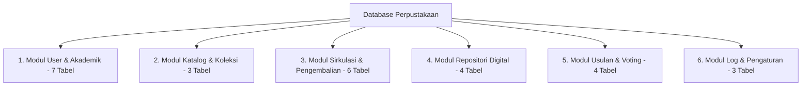
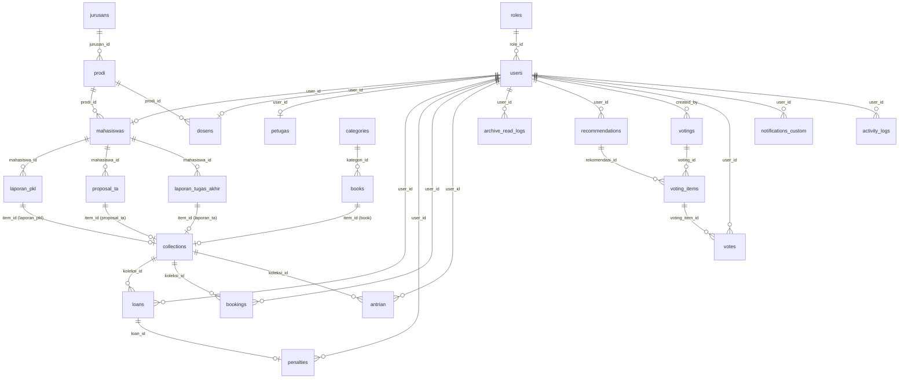

# DOKUMENTASI LENGKAP ERD & SKEMA DATABASE
## Sistem Informasi Perpustakaan (SIP)

Dokumen ini berisi dokumentasi teknis dan akademis mengenai **Entity Relationship Diagram (ERD)**, **Diagram Relasi Tabel (Physical Relational Database Schema)**, serta **Kamus Data Lengkap** untuk 27 tabel aplikasi pada Sistem Informasi Perpustakaan.

---

## 1. Ringkasan Skema Database

Database sistem perpustakaan dirancang menggunakan sistem manajemen basis data relasional (RDBMS) MySQL / PostgreSQL berbasis framework Laravel. Total tabel dalam sistem ini berjumlah **34 tabel**, terdiri dari:
- **27 Tabel Utama Fitur Aplikasi**
- **7 Tabel Bawaan System Framework** (Session, Cache, Queue Jobs, Token Reset Password)

---

## 2. Pengelompokan Modul Database (27 Tabel)

### A. Modul Pengguna & Struktur Akademik (7 Tabel)
1. `roles` - Hak akses & peran pengguna (Admin, Petugas, Mahasiswa, Dosen).
2. `users` - Akun utama kredensial pengguna (email, password, nama).
3. `jurusans` - Master data Jurusan di kampus.
4. `prodi` - Master data Program Studi (menginduk ke `jurusans`).
5. `mahasiswas` - Profil spesifik mahasiswa (NIM, Semester, relasi 1:1 ke `users` & 1:N ke `prodi`).
6. `dosens` - Profil spesifik dosen (NIP, relasi 1:1 ke `users` & 1:N ke `prodi`).
7. `petugas` - Profil staf perpustakaan (NIP, Jabatan, relasi 1:1 ke `users`).

### B. Modul Katalog & Koleksi (3 Tabel)
8. `categories` - Master kategori/subjek buku.
9. `books` - Data katalog fisik buku (Judul, Pengarang, Penerbit, Tahun, Stok).
10. `collections` - Central table sirkulasi polimorfik (`item_type` & `item_id`) untuk barang fisik (buku) maupun barang digital (laporan PKL/TA).

### C. Modul Sirkulasi & Pengembalian (6 Tabel)
11. `loans` - Transaksi peminjaman fisik (Tgl Pinjam, Batas Kembali, Status Pengembalian, Inspeksi Fisik).
12. `bookings` - Reservasi buku fisik secara online sebelum diambil di perpustakaan.
13. `antrian` - Pendaftaran antrian apabila stok buku fisik sedang kosong.
14. `penalties` - Rekap sanksi/denda atas keterlambatan, kerusakan, atau kehilangan.
15. `penalty_rules` - Master aturan tarif denda (per hari / flat / ganti buku).
16. `return_checklists` - Master checklist kelayakan fisik buku saat pengembalian.

### D. Modul Repositori & Log Akses Digital (4 Tabel)
17. `laporan_pkl` - Repositori Laporan Praktik Kerja Lapangan mahasiswa.
18. `proposal_ta` - Repositori Proposal Tugas Akhir mahasiswa.
19. `laporan_tugas_akhir` - Repositori Laporan Akhir Tugas Akhir / Skripsi mahasiswa.
20. `archive_read_logs` - Log durasi dan riwayat membaca arsip digital oleh pemustaka.

### E. Modul Pengadaan Usulan & Voting (4 Tabel)
21. `recommendations` - Usulan judul buku baru dari pemustaka.
22. `votings` - Sesi polling/voting pengadaan buku baru yang dibuka petugas.
23. `voting_items` - Item kandidat rekomendasi dalam sesi voting.
24. `votes` - Rekapitulasi suara yang diberikan oleh pengguna.

### F. Modul Pengaturan & Notifikasi (3 Tabel)
25. `notifications_custom` - Notifikasi pesan internal pengguna.
26. `activity_logs` - Log jejak aktivitas pengguna di sistem.
27. `app_settings` - Konfigurasi variabel global aplikasi.

---

## 3. Diagram Relasi Tabel (Mermaid ERD)

---

## 4. Kamus Data Lengkap (Data Dictionary 27 Tabel)

Berikut adalah tabel rincian atribut, tipe data, dan kunci (Primary Key & Foreign Key) untuk seluruh 27 tabel aplikasi:

| No | Nama Tabel | Primary Key (PK) | Foreign Key (FK) | Kolom Utama Lainnya | Fungsi & Deskripsi |
| :---: | :--- | :--- | :--- | :--- | :--- |
| 1 | `roles` | `role_id` | - | `role_name` | Hak akses peran pengguna |
| 2 | `users` | `user_id` | `role_id` | `name`, `email`, `password`, `no_hp`, `foto` | Data akun pengguna sistem |
| 3 | `jurusans` | `jurusan_id` | - | `nama_jurusan` | Master data Jurusan kampus |
| 4 | `prodi` | `prodi_id` | `jurusan_id` | `nama_prodi` | Master data Program Studi |
| 5 | `mahasiswas` | `mhs_id` | `user_id`, `prodi_id` | `nim`, `semester` | Profil mahasiswa (NIM unik) |
| 6 | `dosens` | `dosen_id` | `user_id`, `prodi_id` | `nip` | Profil dosen (NIP unik) |
| 7 | `petugas` | `staff_id` | `user_id` | `nip`, `jabatan` | Profil petugas perpustakaan |
| 8 | `categories` | `kategori_id` | - | `kategori_name` | Kategori buku |
| 9 | `books` | `buku_id` | `kategori_id` | `judul`, `author`, `publisher`, `release`, `stock` | Katalog fisik buku |
| 10 | `collections` | `koleksi_id` | `item_id` (Polymorphic) | `item_type`, `stock` | Item koleksi sirkulasi |
| 11 | `loans` | `loan_id` | `user_id`, `koleksi_id` | `tgl_pinjam`, `bts_waktu`, `tgl_kembali`, `status` | Transaksi peminjaman fisik |
| 12 | `bookings` | `booking_id` | `user_id`, `koleksi_id` | `tgl_booking`, `status`, `batas_waktu_ambil` | Reservasi buku online |
| 13 | `antrian` | `antrian_id` | `user_id`, `koleksi_id` | `no_antrian`, `status` | Antrian buku kosong |
| 14 | `penalties` | `penalti_id` | `loan_id`, `user_id` | `type`, `amount`, `status` | Sanksi/denda peminjaman |
| 15 | `penalty_rules` | `penalty_rule_id` | - | `code`, `rule_name`, `default_amount` | Master aturan denda |
| 16 | `return_checklists` | `return_checklist_id` | - | `item_name`, `sort_order`, `is_active` | Master checklist pengembalian |
| 17 | `laporan_pkl` | `id` | `mahasiswa_id` | `judul_pkl`, `nama_tempat_pkl`, `file_pdf` | Repositori Laporan PKL |
| 18 | `proposal_ta` | `id` | `mahasiswa_id` | `judul_proposal`, `file_pdf`, `status` | Repositori Proposal TA |
| 19 | `laporan_tugas_akhir` | `id` | `mahasiswa_id` | `judul_tgs_akhir`, `file_pdf`, `status` | Repositori Laporan Akhir TA |
| 20 | `archive_read_logs` | `id` | `user_id` | `archive_id`, `archive_type`, `finished_at` | Log baca arsip digital |
| 21 | `recommendations` | `rekomendasi_id` | `user_id` | `title`, `author`, `reason`, `status` | Usulan pengadaan buku |
| 22 | `votings` | `voting_id` | `created_by` | `title`, `tgl_mulai`, `tgl_selesai` | Sesi polling pengadaan |
| 23 | `voting_items` | `voting_item_id` | `voting_id`, `rekomendasi_id` | - | Item pilihan voting |
| 24 | `votes` | `vote_id` | `voting_item_id`, `user_id` | - | Suara pemilih |
| 25 | `notifications_custom` | `id` | `user_id` | `title`, `message`, `is_read` | Notifikasi internal user |
| 26 | `activity_logs` | `id` | `user_id` | `activity` | Log aktivitas pengguna |
| 27 | `app_settings` | `id` | - | `key`, `value`, `description` | Setting global sistem |

---

## 5. Penjelasan Kardinalitas & Keterhubungan Relasi

1. **One-to-One ($1 : 1$)**:
   - `users` ke `mahasiswas` / `dosens` / `petugas`: Setiap akun pengguna terhubung ke satu data spesifik profil.
2. **One-to-Many ($1 : N$)**:
   - `roles` ke `users`: 1 Role dipakai banyak User.
   - `jurusans` ke `prodi`: 1 Jurusan membawahi banyak Prodi.
   - `prodi` to `mahasiswas` / `dosens`: 1 Prodi menampung banyak Mahasiswa dan Dosen.
   - `categories` ke `books`: 1 Kategori membawahi banyak Judul Buku.
   - `mahasiswas` ke `laporan_pkl` / `proposal_ta` / `laporan_tugas_akhir`: 1 Mahasiswa dapat mengunggah berkas karya ilmiah.
   - `loans` ke `penalties`: 1 Transaksi peminjaman dapat menghasilkan catatan denda.
3. **Many-to-Many ($N : M$)**:
   - `users` ke `collections` terhubung via tabel perantara `loans` (Peminjaman), `bookings` (Reservasi), dan `antrian` (Antrian).
4. **Relasi Polimorfik (*Polymorphic Relation*)**:
   - Tabel `collections` menggunakan kolom `item_type` (`book`, `laporan_pkl`, `proposal_ta`, `laporan_ta`) dan `item_id` untuk menghubungkan secara fleksibel berbagai jenis barang fisik dan dokumen digital dalam 1 sistem sirkulasi peminjaman terpadu.

---

*Dokumen ini dibuat otomatis sebagai panduan dokumentasi perancangan ERD dan skema database Sistem Informasi Perpustakaan.*
