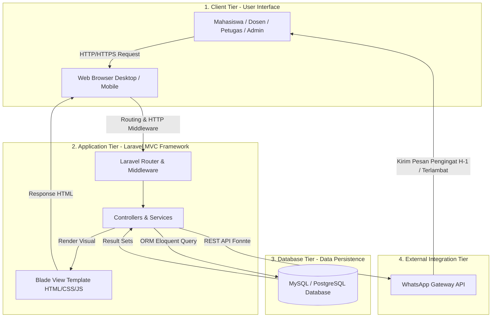

# DRAFT BAB IV - IMPLEMENTASI DAN PENGUJIAN SISTEM

## 4.1 Gambaran Umum Sistem

### 4.1.1 Penjelasan Umum Aplikasi
Sistem Informasi Perpustakaan (SIP) merupakan aplikasi berbasis web (*web-based application*) yang dirancang untuk mengintegrasikan dan mengotomatisasi seluruh proses bisnis sirkulasi perpustakaan serta manajemen repositori karya ilmiah di lingkungan perguruan tinggi. Sistem ini dibangun menggunakan arsitektur Model-View-Controller (MVC) dengan framework PHP Laravel.

Sistem menyediakan 4 peran utama pengguna (*roles*):
1. **Admin**: Mengelola data master pengguna, peran, jurusan, prodi, dan pengaturan global sistem.
2. **Petugas Perpustakaan**: Mengelola sirkulasi fisik (peminjaman, pengembalian, inspeksi kelayakan fisik, denda), reservasi booking, antrian, serta verifikasi karya ilmiah digital.
3. **Mahasiswa**: Melakukan pencarian buku, booking online, antrian stok kosong, pengajuan usulan buku, voting pengadaan, membaca arsip digital, dan mengunggah Laporan PKL, Proposal TA, serta Skripsi/TA.
4. **Dosen**: Mengakses katalog buku, membaca arsip repositori digital, serta berpartisipasi dalam usulan & voting pengadaan buku.

---

### 4.1.2 Diagram Arsitektur Sistem dan Alur Kerja
Arsitektur Sistem Informasi Perpustakaan dirancang menggunakan pendekatan **Multi-Tier Web Architecture** yang terdiri dari Client Tier, Application Tier, Database Tier, dan External Service Tier.

*Gambar 4.1 Diagram Arsitektur Sistem Informasi Perpustakaan*

#### Alur Kerja Sistem Secara Keseluruhan:
1. **Permintaan Pengguna (Client Tier)**: Pengguna mengakses aplikasi melalui browser (Desktop/Smartphone). Request dikirimkan via protokol HTTP/HTTPS.
2. **Pemrosesan Logika Bisnis (Application Tier)**: Laravel Router mengarahkan request ke Middleware (autentikasi & otorisasi peran), kemudian diteruskan ke Controller yang sesuai. Controller memproses logika bisnis (seperti validasi peminjaman, reservasi booking, kalkulasi denda, atau verifikasi arsip).
3. **Penyimpanan & Pengambilan Data (Database Tier)**: Controller berinteraksi dengan basis data relasional MySQL melalui Eloquent ORM untuk mengambil atau memperbarui data dari 34 tabel sistem.
4. **Pengiriman Notifikasi Otomatis (External Service Tier)**: Sistem terhubung secara otomatis dengan API Fonnte WhatsApp Gateway untuk mengirimkan pesan pengingat jatuh tempo (H-1) dan notifikasi keterlambatan langsung ke nomor WhatsApp pemustaka.

---

### 4.1.3 Spesifikasi Perangkat Keras dan Perangkat Lunak

Untuk menjamin kelancaran implementasi dan pengoperasian sistem, berikut adalah rincian spesifikasi perangkat keras (*hardware*) dan perangkat lunak (*software*) yang digunakan:

#### 1. Spesifikasi Perangkat Lunak (Software Specifications)
| No | Komponen / Perangkat Lunak | Spesifikasi / Versi | Fungsi / Peranan |
| :---: | :--- | :--- | :--- |
| 1 | Operating System (Server/Dev) | Windows 10 / 11 64-bit | Lingkungan pengembangan & eksekusi server |
| 2 | Programming Language | PHP v8.2+ | Bahasa pemrogram utama logika sistem |
| 3 | Web Framework | Laravel v11.x | Framework pengembang aplikasi MVC |
| 4 | Database Management System | MySQL v8.0 / MariaDB v10.4 | Pengelola basis data relasional |
| 5 | Web Server | Nginx / Apache (XAMPP / Laravel Artisan) | Server penangan request HTTP/HTTPS |
| 6 | Frontend Technologies | HTML5, CSS3, JavaScript (Vanilla/Blade) | Antarmuka pengguna (*User Interface*) |
| 7 | External API Gateway | Fonnte WhatsApp Gateway API | Layanan pengirim notifikasi pesan otomatis |
| 8 | Version Control & IDE | Git & Visual Studio Code / Antigravity IDE | Editor kode & pengelola versi program |
| 9 | Web Browser (Client) | Google Chrome / Mozilla Firefox / Edge | Aplikasi pengakses bagi pemustaka |

#### 2. Spesifikasi Perangkat Keras (Hardware Specifications)
| No | Komponen Perangkat Keras | Spesifikasi Minimum (Server) | Spesifikasi Minimum (Client) |
| :---: | :--- | :--- | :--- |
| 1 | Processor (CPU) | Intel Core i3 Gen 10 / AMD Ryzen 3 (Quad-Core 2.4 GHz+) | Dual-Core 1.6 GHz / ARM Processor (Smartphone) |
| 2 | Memory (RAM) | 8 GB DDR4 | 2 GB DDR3 / 2 GB RAM (Smartphone) |
| 3 | Storage (Harddisk / SSD) | SSD 256 GB (Rekomendasi NVMe) | SSD / HDD 10 GB ruang kosong |
| 4 | Display / Screen | Monitor Resolution 1366x768 | Monitor Resolution 1024x768 / Mobile Screen |
| 5 | Network Interface | Network Adapter & Internet Line (Min 10 Mbps) | Koneksi Internet / Wi-Fi / Cellular Data |
