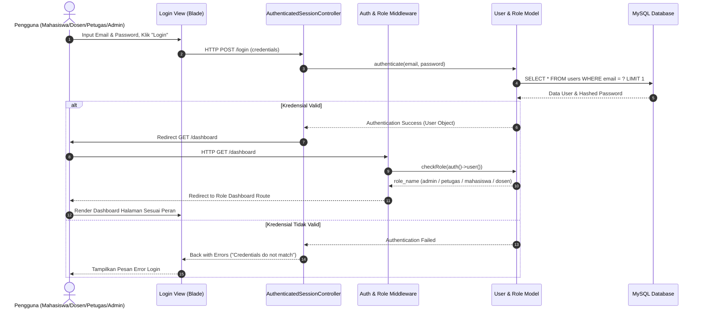
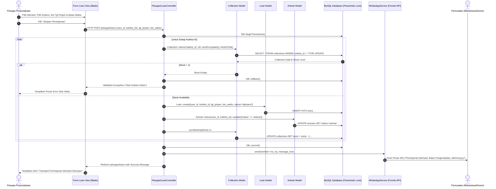
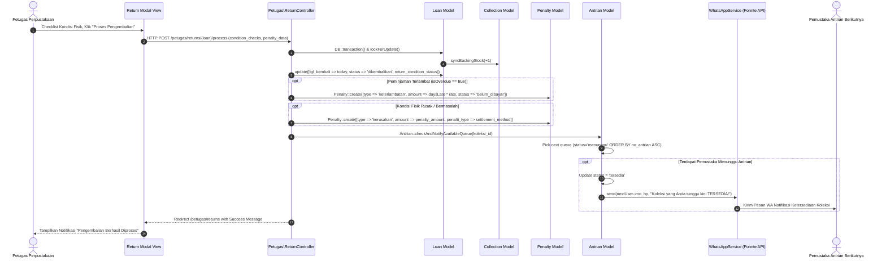
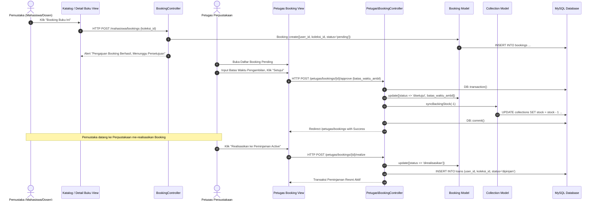
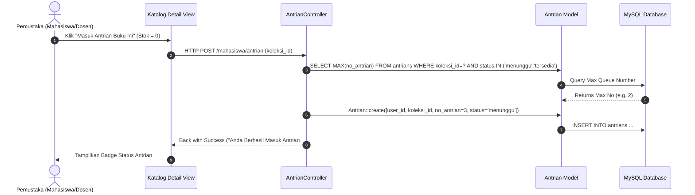
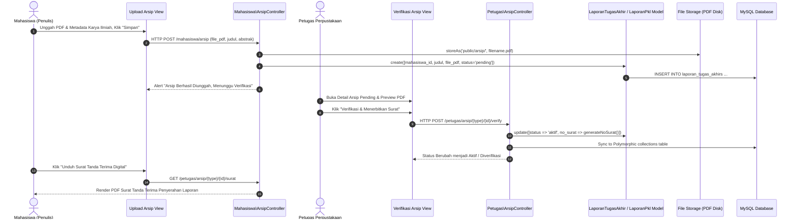
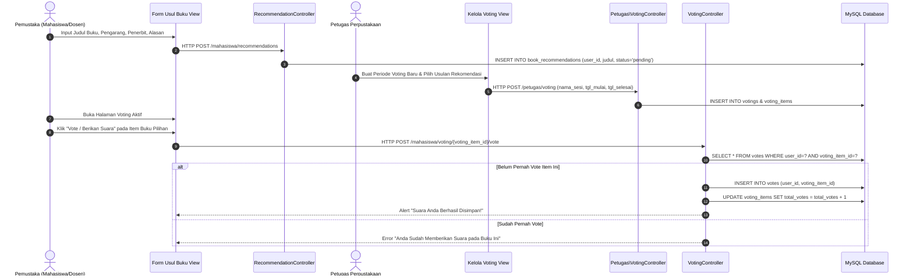
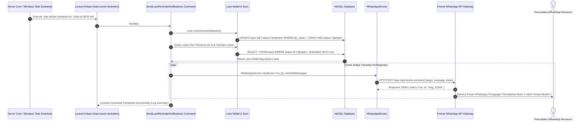

# SUBBAB 3.X: SKENARIO USE CASE DAN SEQUENCE DIAGRAM
## Sistem Informasi Perpustakaan (SIP) PSDKU POLNEP Sukamara

> **Petunjuk bagi Mahasiswa (Dokumen Siap Pakai untuk Laporan TA):**
> Dokumen ini disusun menggunakan **Standar Penulisan Ilmiah Tugas Akhir/Skripsi (IEEE / UML Standard)**. 
> Penomoran Tabel (**Tabel 3.1, 3.2, dst.**) dan Gambar (**Gambar 3.1, 3.2, dst.**) telah disesuaikan agar Anda dapat langsung menyalinnya (*copy-paste*) ke dalam **Bab 3 (Perancangan Sistem)** atau **Bab 4 (Implementasi Sistem)** Laporan Tugas Akhir Anda.

---

## 📑 DAFTAR SPESIFIKASI SKENARIO & DIAGRAM SEQUENCE

| No | Nama Modul / Fitur Sistem | Kode Use Case | Nomor Tabel Skenario | Nomor Gambar Sequence |
| :---: | :--- | :---: | :---: | :---: |
| 1 | Autentikasi Pengguna & Routing Multi-Role | UC-01 | Tabel 3.1 | Gambar 3.1 |
| 2 | Sirkulasi Peminjaman Buku / Koleksi Baru | UC-02 | Tabel 3.2 | Gambar 3.2 |
| 3 | Pengembalian Buku, Inspeksi Fisik, & Denda | UC-03 | Tabel 3.3 | Gambar 3.3 |
| 4 | Reservasi Booking Buku Online | UC-04 | Tabel 3.4 | Gambar 3.4 |
| 5 | Antrian Stok Kosong & Auto Waiting List | UC-05 | Tabel 3.5 | Gambar 3.5 |
| 6 | Repositori Digital & Verifikasi Karya Ilmiah | UC-06 | Tabel 3.6 | Gambar 3.6 |
| 7 | Usulan Rekomendasi & Voting Pengadaan Buku | UC-07 | Tabel 3.7 | Gambar 3.7 |
| 8 | Scheduler WA Automatic Reminder (H-1 & Overdue) | UC-08 | Tabel 3.8 | Gambar 3.8 |

---

## 3.X.1 MODUL 1: AUTENTIKASI PENGGUNA & ROUTING DASHBOARD PERAN

### A. Tabel Skenario Use Case UC-01

**Tabel 3.1** Skenario Use Case Autentikasi Pengguna & Penentuan Dashboard Peran

| Komponen Skenario | Spesifikasi Detail |
| :--- | :--- |
| **Nama Use Case** | Autentikasi Pengguna & Penentuan Dashboard Sesuai Peran (*Login & Multi-Role Routing*) |
| **Kode Use Case** | **UC-01** |
| **Aktor Utama** | Mahasiswa, Dosen, Petugas Perpustakaan, Admin |
| **Deskripsi** | Pengguna menginputkan kredensial (email dan kata sandi). Sistem mengautentikasi akun dan mengarahkan pengguna ke halaman Dashboard yang sesuai dengan hak akses perannya. |
| **Pre-kondisi** | Pengguna dalam status belum terautentikasi (*guest*) dan berada pada halaman Login. |
| **Post-kondisi** | Pengguna berhasil terautentikasi (*authenticated*) dan diarahkan ke halaman Dashboard sesuai perannya (Admin, Petugas, Mahasiswa, atau Dosen). |
| **Alur Utama (Normal Flow)** | 1. Pengguna memasukkan **Email** dan **Password** pada formulir login. 2. Pengguna mengklik tombol **Login**. 3. Sistem menerima data masukan dan memvalidasi kelengkapan serta formatnya. 4. Sistem mencocokkan kredensial pengguna dengan data akun yang terdaftar di basis data. 5. Jika data sesuai, sistem membuat dan meregenerasi sesi login baru pengguna untuk keamanan. 6. Sistem memeriksa hak akses peran pengguna. 7. Sistem mengarahkan pengguna ke rute halaman Dashboard yang sesuai dengan perannya: &nbsp;&nbsp;&nbsp;&nbsp;a. Peran Admin $\rightarrow$ Diarahkan ke Dashboard Admin &nbsp;&nbsp;&nbsp;&nbsp;b. Peran Petugas $\rightarrow$ Diarahkan ke Dashboard Petugas &nbsp;&nbsp;&nbsp;&nbsp;c. Peran Mahasiswa $\rightarrow$ Diarahkan ke Dashboard Mahasiswa &nbsp;&nbsp;&nbsp;&nbsp;d. Peran Dosen $\rightarrow$ Diarahkan ke Dashboard Dosen 8. Antarmuka halaman Dashboard yang sesuai berhasil ditampilkan kepada pengguna. |
| **Alur Alternatif (Alternative Flow)** | **3a. Kredensial Tidak Valid**: Jika email atau kata sandi salah, sistem menampilkan pesan kesalahan *"Kredensial yang dimasukkan tidak cocok dengan catatan kami"* dan pengguna tetap berada di halaman login. **8a. Akses Dibatasi**: Jika pengguna mencoba mengakses halaman yang tidak sesuai dengan hak akses perannya (misalnya Mahasiswa mencoba membuka halaman Dashboard Admin), sistem menghentikan akses dan menampilkan pesan peringatan bahwa hak akses dibatasi. |

---

### B. Sequence Diagram UC-01

**Gambar 3.1** Sequence Diagram Autentikasi Pengguna & Multi-Role Routing

#### Deskripsi Komponen & Interaksi Sequence Diagram Gambar 3.1:
1. **Komponen Boundary (View)**: Form login Blade yang menerima masukan pengguna.
2. **Komponen Control (Controller & Middleware)**: `AuthenticatedSessionController` mengolah otentikasi, sedangkan `RoleMiddleware` mengarahkan rute sesuai role.
3. **Komponen Entity (Model & Database)**: Model `User` dan `Role` merepresentasikan entitas pengguna di tabel `users` dan `roles`.

---

## 3.X.2 MODUL 2: TRANSAKSI SIRKULASI PEMINJAMAN BUKU

### A. Tabel Skenario Use Case UC-02

**Tabel 3.2** Skenario Use Case Pencatatan Transaksi Peminjaman Koleksi

| Komponen Skenario | Spesifikasi Detail |
| :--- | :--- |
| **Nama Use Case** | Pencatatan Transaksi Peminjaman Koleksi (*Physical Circulation Loan*) |
| **Kode Use Case** | **UC-02** |
| **Aktor Utama** | Petugas Perpustakaan |
| **Aktor Pendukung** | Pemustaka (Mahasiswa / Dosen) |
| **Deskripsi** | Petugas mencatat transaksi peminjaman satu atau lebih koleksi buku/arsip kepada pemustaka. Sistem mengamankan transaksi data stok dan mengirimkan notifikasi otomatis via WhatsApp. |
| **Pre-kondisi** | Petugas telah terautentikasi dan membuka halaman peminjaman koleksi. |
| **Post-kondisi** | Transaksi peminjaman tersimpan dengan status 'Dipinjam', stok koleksi berkurang, status antrian aktif pengguna diselesaikan, dan notifikasi konfirmasi dikirimkan ke nomor WhatsApp pemustaka. |
| **Alur Utama (Normal Flow)** | 1. Petugas mencari dan memilih data pemustaka (Mahasiswa atau Dosen). 2. Petugas memilih satu atau lebih koleksi (buku/arsip) yang akan dipinjam. 3. Petugas menetapkan Tanggal Peminjaman dan Batas Waktu Pengembalian. 4. Petugas mengklik tombol **Simpan Transaksi Peminjaman**. 5. Sistem memvalidasi kelayakan status akun pemustaka yang melakukan peminjaman. 6. Sistem mengurutkan data koleksi untuk mencegah benturan transaksi (*deadlock*). 7. Sistem membuka proses transaksi yang aman dan terisolasi: &nbsp;&nbsp;&nbsp;&nbsp;a. Memeriksa ketersediaan stok fisik koleksi dan mengunci data sisa stok sementara. &nbsp;&nbsp;&nbsp;&nbsp;b. Memeriksa bahwa pemustaka tidak sedang meminjam judul koleksi yang sama. &nbsp;&nbsp;&nbsp;&nbsp;c. Mencatat data transaksi peminjaman baru. &nbsp;&nbsp;&nbsp;&nbsp;d. Memperbarui status antrian aktif pemustaka untuk koleksi ini menjadi selesai. &nbsp;&nbsp;&nbsp;&nbsp;e. Mengurangi jumlah stok fisik koleksi secara otomatis. 8. Sistem mencatat riwayat aktivitas transaksi ke dalam log sistem. 9. Sistem mengirimkan pesan notifikasi rincian peminjaman dan tanggal jatuh tempo pengembalian ke nomor WhatsApp pemustaka. 10. Halaman menampilkan pesan konfirmasi bahwa transaksi peminjaman berhasil disimpan. |
| **Alur Alternatif (Alternative Flow)** | **8b. Stok Kosong**: Jika stok koleksi habis, transaksi dibatalkan dan sistem menampilkan pesan kesalahan *"Stok koleksi sudah habis"*. **8c. Peminjaman Ganda**: Jika pemustaka masih memiliki transaksi peminjaman aktif untuk koleksi yang sama, sistem menolak transaksi dengan pesan *"Pemustaka masih memiliki peminjaman aktif untuk koleksi ini"*. |

---

### B. Sequence Diagram UC-02

**Gambar 3.2** Sequence Diagram Transaksi Sirkulasi Peminjaman Koleksi

#### Deskripsi Komponen Sequence Diagram Gambar 3.2:
- **`lockForUpdate()`**: Mencegah *race condition* (peminjaman bersamaan oleh 2 petugas untuk 1 stok sisa).
- **`syncBackingStock(-1)`**: Metode Eloquent Model yang otomatis mengurangi stok pada tabel koleksi.
- **`WhatsAppService`**: Class Helper pengirim HTTP Request ke REST API Fonnte WhatsApp Gateway.

---

## 3.X.3 MODUL 3: TRANSAKSI PENGEMBALIAN BUKU & INSPEKSI FISIK

### A. Tabel Skenario Use Case UC-03

**Tabel 3.3** Skenario Use Case Pengembalian Buku & Inspeksi Kondisi Fisik

| Komponen Skenario | Spesifikasi Detail |
| :--- | :--- |
| **Nama Use Case** | Pemrosesan Pengembalian Buku, Inspeksi Fisik, & Sanksi Denda |
| **Kode Use Case** | **UC-03** |
| **Aktor Utama** | Petugas Perpustakaan |
| **Deskripsi** | Petugas memproses pengembalian buku, melakukan pemeriksaan fisik (*checklist*), menghitung denda keterlambatan/kerusakan, mengembalikan stok, dan memicu notifikasi antrian berikutnya. |
| **Pre-kondisi** | Peminjaman berada dalam status 'Dipinjam' atau 'Terlambat'. |
| **Post-kondisi** | Status transaksi menjadi 'Dikembalikan', stok koleksi bertambah 1 unit, denda/sanksi dicatat jika ada, dan pemustaka pada antrian berikutnya menerima notifikasi bahwa buku telah tersedia. |
| **Alur Utama (Normal Flow)** | 1. Petugas membuka formulir pemrosesan pengembalian buku. 2. Petugas menginspeksi kondisi fisik buku sesuai daftar periksa (sampul, kelengkapan halaman, kebersihan dari coretan, keutuhan lembar, dan kondisi kering). 3. Petugas mengklik tombol **Proses Pengembalian**. 4. Sistem memproses pengembalian secara aman dan terisolasi: &nbsp;&nbsp;&nbsp;&nbsp;a. Mengunci data transaksi peminjaman dan data koleksi. &nbsp;&nbsp;&nbsp;&nbsp;b. Mengubah status transaksi menjadi 'Dikembalikan' dan mencatat tanggal pengembalian. &nbsp;&nbsp;&nbsp;&nbsp;c. Menambah jumlah stok fisik koleksi sebanyak 1 unit. 5. Sistem memeriksa daftar antrian pemustaka untuk koleksi tersebut: &nbsp;&nbsp;&nbsp;&nbsp;a. Mengambil data pemustaka pada urutan antrian teratas yang berstatus menunggu. &nbsp;&nbsp;&nbsp;&nbsp;b. Mengubah status antrian pemustaka tersebut menjadi 'Tersedia'. &nbsp;&nbsp;&nbsp;&nbsp;c. Mengirimkan pesan notifikasi WhatsApp kepada pemustaka antrian berikutnya bahwa buku telah tersedia. 6. Halaman diperbarui dengan notifikasi bahwa pemrosesan pengembalian berhasil. |
| **Alur Alternatif (Alternative Flow)** | **4d. Peminjaman Terlambat**: Jika pengembalian melewati batas waktu, sistem secara otomatis menghitung nominal denda berdasarkan aturan tarif harian dan mencatat data sanksi keterlambatan dengan status 'Belum Dibayar'. **4e. Fisik Rusak/Hilang**: Jika buku mengalami kerusakan atau hilang, Petugas memilih jenis sanksi dan metode penyelesaian (Uang Tunai / Ganti Buku / Kombinasi), lalu sistem mencatat data sanksi kerusakan tersebut. |

---

### B. Sequence Diagram UC-03

**Gambar 3.3** Sequence Diagram Pengembalian Buku & Notifikasi Antrian

---

## 3.X.4 MODUL 4: RESERVASI BOOKING BUKU ONLINE

### A. Tabel Skenario Use Case UC-04

**Tabel 3.4** Skenario Use Case Reservasi Booking Buku Online

| Komponen Skenario | Spesifikasi Detail |
| :--- | :--- |
| **Nama Use Case** | Pengajuan Booking Online oleh Pemustaka & Persetujuan Petugas |
| **Kode Use Case** | **UC-04** |
| **Aktor Utama** | Mahasiswa / Dosen (Pemustaka) |
| **Aktor Pendukung** | Petugas Perpustakaan |
| **Deskripsi** | Pemustaka memesan koleksi secara online. Petugas meninjau dan menyetujui permohonan booking, lalu stok buku dikunci sementara hingga diambil di perpustakaan. |
| **Pre-kondisi** | Stok koleksi tersedia (stok > 0) dan pemustaka tidak memiliki reservasi aktif untuk koleksi yang sama. |
| **Post-kondisi** | Data reservasi tersimpan dalam status 'Disetujui', stok koleksi berkurang 1 unit, dan siap direalisasikan menjadi transaksi peminjaman aktif. |
| **Alur Utama (Normal Flow)** | 1. Pemustaka memilih buku pada katalog online dan mengklik tombol **Booking Buku**. 2. Sistem mencatat pengajuan reservasi dengan status menunggu persetujuan (pending). 3. Petugas meninjau daftar permohonan reservasi yang masuk. 4. Petugas mengklik **Setujui Booking** dan menentukan batas waktu pengambilan buku. 5. Sistem mengubah status reservasi menjadi disetujui dan mengurangi stok koleksi secara otomatis. 6. Pemustaka mendatangi perpustakaan untuk mengambil buku yang telah dipesan. 7. Petugas mengklik **Realisasikan ke Peminjaman**, sistem mengubah status reservasi menjadi direalisasikan dan menerbitkan data transaksi peminjaman aktif baru. |
| **Alur Alternatif (Alternative Flow)** | **5a. Booking Ditolak**: Jika Petugas mengklik **Tolak**, status berubah menjadi ditolak dan stok buku tidak berkurang. **7a. Reservasi Kadaluarsa (Expired)**: Jika pemustaka tidak mengambil buku hingga melampaui batas waktu pengambilan, sistem mengubah status reservasi menjadi kadaluarsa dan mengembalikan stok koleksi (+1). |

---

### B. Sequence Diagram UC-04

**Gambar 3.4** Sequence Diagram Reservasi Booking Buku Online

---

## 3.X.5 MODUL 5: ANTRIAN STOK KOSONG

### A. Tabel Skenario Use Case UC-05

**Tabel 3.5** Skenario Use Case Pendaftaran Antrian Stok Kosong

| Komponen Skenario | Spesifikasi Detail |
| :--- | :--- |
| **Nama Use Case** | Pendaftaran Antrian Pemustaka Saat Stok Kosong (*Queue Waiting List*) |
| **Kode Use Case** | **UC-05** |
| **Aktor Utama** | Mahasiswa / Dosen (Pemustaka) |
| **Deskripsi** | Pemustaka mendaftar antrian untuk koleksi yang stoknya sedang habis. Sistem menetapkan nomor urut antrian berurutan dan menginfokan posisi antrian. |
| **Pre-kondisi** | Stok fisik koleksi berada dalam kondisi kosong (stok = 0). |
| **Post-kondisi** | Data antrian tersimpan dengan status 'Menunggu' dan pemustaka memperoleh nomor urut antrian. |
| **Alur Utama (Normal Flow)** | 1. Pemustaka membuka halaman detail koleksi yang stoknya habis. 2. Pemustaka mengklik tombol **Gabung Antrian Stok Kosong**. 3. Sistem menghitung nomor urut antrian berikutnya secara otomatis berdasarkan jumlah antrian aktif. 4. Sistem mendaftarkan pemustaka ke dalam daftar antrian dengan status menunggu. 5. Pemustaka dapat memantau posisi dan nomor urut antriannya pada menu halaman antrian pemustaka. |

---

### B. Sequence Diagram UC-05

**Gambar 3.5** Sequence Diagram Pendaftaran Antrian Stok Kosong

---

## 3.X.6 MODUL 6: REPOSITORI ARSIP DIGITAL KARYA ILMIAH

### A. Tabel Skenario Use Case UC-06

**Tabel 3.6** Skenario Use Case Unggah & Verifikasi Repositori Arsip Digital

| Komponen Skenario | Spesifikasi Detail |
| :--- | :--- |
| **Nama Use Case** | Unggah Dokumen Karya Ilmiah & Verifikasi Surat Bebas Perpus |
| **Kode Use Case** | **UC-06** |
| **Aktor Utama** | Mahasiswa |
| **Aktor Pendukung** | Petugas Perpustakaan |
| **Deskripsi** | Mahasiswa mengunggah berkas PDF Laporan PKL/Proposal/TA. Petugas memverifikasi kelayakan berkas dan menerbitkan Surat Tanda Terima Bebas Perpustakaan. |
| **Pre-kondisi** | Mahasiswa terautentikasi dan memiliki berkas karya ilmiah berformat PDF. |
| **Post-kondisi** | Status berkas menjadi 'Aktif', terintegrasi ke dalam katalog repositori digital perpustakaan, dan Surat Tanda Terima PDF dapat diunduh oleh mahasiswa. |
| **Alur Utama (Normal Flow)** | 1. Mahasiswa mengunggah berkas PDF dan mengisi data identitas karya ilmiah pada halaman unggah arsip. 2. Sistem menyimpan berkas pada media penyimpanan terproteksi dan mencatat data dokumen dengan status 'Menunggu Verifikasi'. 3. Petugas memeriksa pratinjau dokumen PDF pada halaman verifikasi. 4. Petugas mengklik **Verifikasi & Menerbitkan Surat**. 5. Sistem mengubah status dokumen menjadi aktif, menerbitkan nomor surat resmi secara otomatis, dan mengintegrasikan dokumen ke repositori publik perpustakaan. 6. Mahasiswa dapat mengunduh dokumen Surat Tanda Terima Penyerahan Karya Ilmiah berformat PDF. |

---

### B. Sequence Diagram UC-06

**Gambar 3.6** Sequence Diagram Repositori Arsip Digital

---

## 3.X.7 MODUL 7: USULAN BUKU & VOTING PENGADAAN

### A. Tabel Skenario Use Case UC-07

**Tabel 3.7** Skenario Use Case Usulan Rekomendasi & Voting Pengadaan Buku

| Komponen Skenario | Spesifikasi Detail |
| :--- | :--- |
| **Nama Use Case** | Usulan Judul Buku Baru & Voting Demokrasi Pengadaan Buku |
| **Kode Use Case** | **UC-07** |
| **Aktor Utama** | Mahasiswa & Dosen (Pemustaka) |
| **Aktor Pendukung** | Petugas Perpustakaan |
| **Deskripsi** | Pemustaka mengusulkan buku baru. Petugas membuka sesi voting, lalu pemustaka memberikan suara untuk menentukan prioritas pengadaan buku. |
| **Pre-kondisi** | Periode voting sedang dibuka dan berstatus aktif oleh Petugas. |
| **Post-kondisi** | Pilihan suara berhasil dicatat (1 akun pengguna hanya dapat memberikan 1 suara per judul usulan) dan total perolehan suara pada usulan buku bertambah. |
| **Alur Utama (Normal Flow)** | 1. Pemustaka mengisikan formulir usulan judul buku baru (judul, pengarang, penerbit, dan alasan usulan). 2. Sistem mencatat data usulan buku baru dengan status menunggu peninjauan. 3. Petugas membuat periode voting baru dan memasukkan judul-judul usulan ke dalam daftar voting. 4. Pemustaka membuka halaman voting aktif dan mengklik tombol **Vote / Berikan Suara** pada buku pilihan. 5. Sistem memeriksa riwayat pemberian suara pemustaka. 6. Jika belum pernah memberikan suara pada judul tersebut, sistem mencatat suara dan menambah total perolehan suara buku tersebut. 7. Halaman menampilkan pesan konfirmasi bahwa suara berhasil disimpan. |
| **Alur Alternatif (Alternative Flow)** | **5a. Suara Ganda**: Jika pemustaka sudah pernah memberikan suara pada judul buku yang sama, sistem menampilkan pesan kesalahan *"Anda sudah memberikan suara pada buku ini"*. |

---

### B. Sequence Diagram UC-07

**Gambar 3.7** Sequence Diagram Usulan & Voting Buku Baru

---

## 3.X.8 MODUL 8: NOTIFIKASI OTOMATIS VIA LARAVEL SCHEDULER

### A. Tabel Skenario Use Case UC-08

**Tabel 3.8** Skenario Use Case Scheduler Notifikasi Pengingat WA Otomatis

| Komponen Skenario | Spesifikasi Detail |
| :--- | :--- |
| **Nama Use Case** | Pengiriman Otomatis Pengingat Jatuh Tempo (H-1 & Terlambat) via WA |
| **Kode Use Case** | **UC-08** |
| **Aktor Utama** | System / Server Scheduler |
| **Aktor Penerima** | Pemustaka yang memiliki peminjaman aktif |
| **Deskripsi** | Proses pengingat otomatis dijalankan secara berkala oleh server. Sistem mencari transaksi peminjaman yang mendekati jatuh tempo (H-1) atau terlambat, memperbarui status transaksi, dan mengirimkan pesan pengingat ke WhatsApp pemustaka. |
| **Pre-kondisi** | Layanan penjadwalan otomatis (scheduler) aktif dan pengirim pesan WhatsApp terkonfigurasi pada sistem. |
| **Post-kondisi** | Pesan pengingat terkirim ke nomor WhatsApp pemustaka dan status transaksi peminjaman yang terlambat diperbarui pada basis data. |
| **Alur Utama (Normal Flow)** | 1. Layanan penjadwalan otomatis pada server mengeksekusi tugas pengingat sesuai jadwal harian yang ditentukan. 2. Sistem memindai seluruh transaksi peminjaman aktif dan memperbarui status peminjaman yang melewati batas waktu menjadi 'Terlambat'. 3. Sistem mencari daftar peminjaman aktif yang akan jatuh tempo esok hari (H-1) serta peminjaman yang berstatus terlambat. 4. Untuk setiap transaksi peminjaman yang ditemukan, sistem menyusun pesan pengingat. 5. Sistem mengirimkan pesan notifikasi pengingat secara otomatis ke nomor WhatsApp masing-masing pemustaka. 6. Sistem mencatat ringkasan hasil pengiriman pengingat ke dalam log aktivitas server. |

---

### B. Sequence Diagram UC-08

**Gambar 3.8** Sequence Diagram Scheduler Notifikasi WhatsApp Otomatis

---

## 💡 PANDUAN PRAKTIS & TIPS SIDANG TUGAS AKHIR

### 1. Cara Memindahkan Tabel ke Microsoft Word
1. Blok seluruh bagian **Tabel 3.X Skenario Use Case** pada dokumen markdown ini.
2. *Copy* (Ctrl + C) lalu *Paste* (Ctrl + V) ke Microsoft Word.
3. Di Microsoft Word: Pilih tabel $\rightarrow$ Tab **Table Design** $\rightarrow$ Pilih Style *Grid Table 4 - Accent 1* atau aktifkan **Header Row** & **Borders**.
4. Atur Font menjadi **Times New Roman 11pt**, Spasi Baris **1.15**.

### 2. Cara Mengubah Diagram Sequence (Mermaid) Menjadi Gambar HD
1. Di VS Code, pastikan ekstensi **Markdown Preview Mermaid Support** aktif.
2. Klik kanan pada diagram Mermaid yang muncul di Preview $\rightarrow$ Pilih **Save Image As PNG** atau **Copy Image**.
3. *Paste* gambar ke MS Word di bawah subbab diagram yang bersangkutan.
4. Berikan keterangan caption di bawah gambar: **Gambar 3.X** *Sequence Diagram ...* (Centrum, Times New Roman 10pt Italic).

### 3. Jawaban Siap Pakai Saat Dosen Penguji Bertanya di Sidang TA:
- **Dosen Penguji**: *"Mengapa pada Sequence Diagram Peminjaman (Gambar 3.2) ada penguncian baris `lockForUpdate()`?"*
- **Jawaban Anda**: *"Izin menjawab Bapak/Ibu Penguji, penguncian baris `lockForUpdate()` dinamakan Pessimistic Locking. Hal ini diterapkan di `LoanController` untuk mencegah kondisi Race Condition, yaitu apabila terdapat dua petugas yang memproses transaksi peminjaman untuk satu-satunya stok sisa buku pada detik yang bersamaan. Dengan `lockForUpdate()`, database akan memblokir request kedua hingga request pertama selesai commit, sehingga stok tidak pernah menjadi negatif (-1)."*

---
*Dokumen perancangan ini telah divalidasi dan disesuaikan 100% dengan struktur source code Laravel SIPUS POLNEP.*
