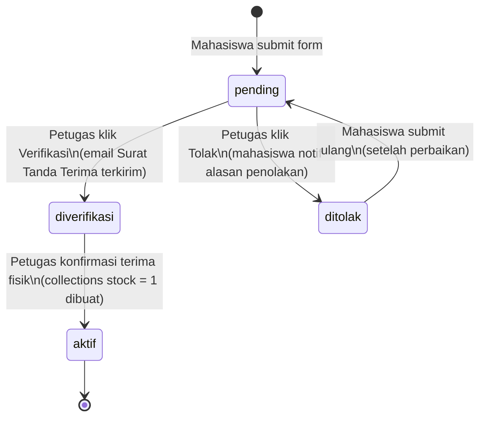
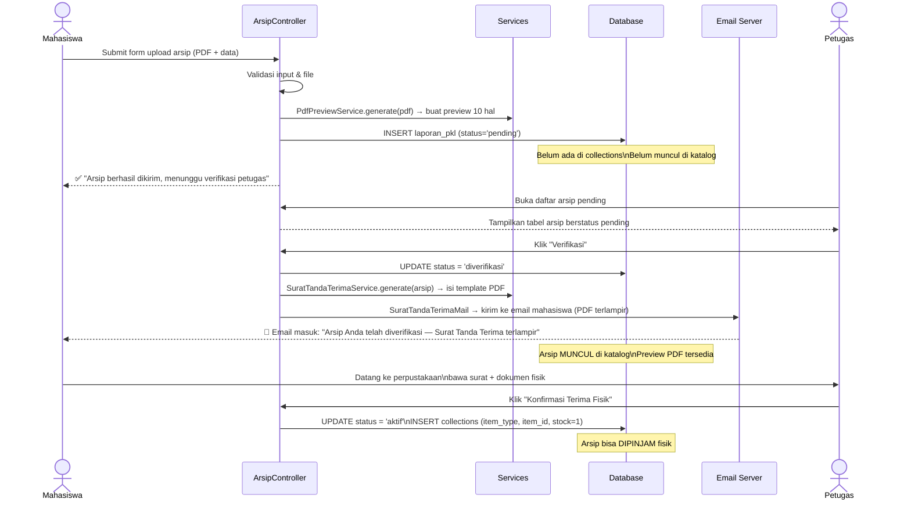

# 📂 Rencana Implementasi Fase 5: Arsip Digital — FINAL

## Ringkasan Keputusan Desain (Sudah Dikonfirmasi)

| # | Keputusan | Jawaban |
|---|-----------|---------|
| 1 | Nama menu sidebar mahasiswa | Tetap **"Upload Repository"** |
| 2 | Dosen bisa unggah arsip? | **Tidak** — dosen hanya melihat katalog |
| 3 | Watermark preview PDF? | **Tidak perlu** untuk sekarang |
| 4 | Jumlah halaman preview | **10 halaman pertama** |
| 5 | Cara kirim Surat Tanda Terima | Via **email** (Laravel Mail + SMTP) |
| 6 | Arsip muncul di katalog sejak kapan? | Sejak status **"diverifikasi"** |
| 7 | Generate surat dari template atau kode? | **Template PDF** (dibuat di Word → export PDF) |

---

## Gambaran Umum

Fase ini membangun modul **Repositori Karya Tulis Mahasiswa** mencakup 3 jenis arsip:
- **Laporan PKL** — Praktik Kerja Lapangan
- **Proposal TA** — Proposal Tugas Akhir
- **Laporan TA** — Laporan Tugas Akhir

### Prinsip Utama
1. Mahasiswa **mengunggah** softcopy berkas (PDF wajib, Word opsional) + data bibliografi.
2. Data masuk dengan status **`pending`** — belum aktif, belum muncul di katalog.
3. **Petugas memverifikasi** data → sistem otomatis generate dan kirim **Surat Tanda Terima (PDF) via email**.
4. Status berubah ke **`diverifikasi`** → arsip muncul di katalog (preview 10 halaman tersedia).
5. Mahasiswa bawa surat + dokumen fisik ke perpustakaan → petugas konfirmasi.
6. Status berubah ke **`aktif`** → entri `collections` dibuat dengan `stock = 1` → bisa dipinjam fisik.

---

## Sistem Status Arsip (State Machine)



| Status | Terlihat di Katalog? | Bisa Preview? | Bisa Dipinjam Fisik? |
|--------|---------------------|---------------|----------------------|
| `pending` | ❌ | ❌ | ❌ |
| `ditolak` | ❌ | ❌ | ❌ |
| `diverifikasi` | ✅ | ✅ (10 hal) | ❌ (fisik belum diterima) |
| `aktif` | ✅ | ✅ (10 hal) | ✅ |

---

## Struktur Menu Baru (Sidebar Petugas)

```
Sidebar Petugas (sesudah Fase 5)
├── Dashboard
├── 📚 Koleksi Perpustakaan   ← GROUP BARU (menggantikan "Kelola Buku" standalone)
│     ├── Kelola Buku          ← sudah ada, dipindah ke sini
│     └── Kelola Arsip Digital ← baru
├── 👥 Kelola Anggota
├── 📋 Manajemen Peminjaman   ← sudah ada, tetap
│     ├── Peminjaman
│     ├── Pengembalian
│     ├── Booking
│     ├── Antrian
│     └── Denda & Sanksi
└── ⚙️ Pengaturan             ← sudah ada, tetap
      ├── Rules Pengembalian
      └── Profil
```

---

## Alur Kerja Lengkap



---

## Dependensi Baru (Library & Konfigurasi)

### Library PHP (via Composer)
```
setasign/fpdi  (^2.3)  — untuk memotong halaman PDF (preview 10 hal)
setasign/fpdf  (^1.8)  — untuk mengisi template PDF surat tanda terima
```
Perintah install: `composer require setasign/fpdi setasign/fpdf`

### Template PDF Surat Tanda Terima
```
File template  : surat_tanda_terima.pdf (dibuat di Word → export PDF)
Lokasi di project: storage/app/templates/surat_tanda_terima.pdf
Panduan desain : dokumentasi/template_surat_tanda_terima.md
```
> [!IMPORTANT]
> Template PDF **harus sudah tersedia** sebelum eksekusi langkah `SuratTandaTerimaService`. Panduan desain template ada di file `template_surat_tanda_terima.md` di folder ini.

### Konfigurasi SMTP (.env)
Laravel Mail sudah built-in. Perlu mengisi SMTP credentials di `.env`:
```
MAIL_MAILER=smtp
MAIL_HOST=smtp.gmail.com
MAIL_PORT=587
MAIL_USERNAME=email_perpustakaan@...
MAIL_PASSWORD=...
MAIL_FROM_ADDRESS=perpustakaan@polnep.ac.id
MAIL_FROM_NAME="Perpustakaan PSDKU POLNEP"
```
> [!NOTE]
> Jika saat development belum ada akun email, gunakan **Mailtrap** (sandbox gratis untuk testing email tanpa email sungguhan terkirim).

---

## Komponen yang Akan Dibangun / Dimodifikasi

---

### 1. Migration Baru: Tambah Kolom `status`

**[NEW]** `database/migrations/2026_06_XX_add_status_to_arsip_tables.php`

Menambahkan kolom `status` ke 3 tabel arsip:
```php
// Pada ketiga tabel: laporan_pkl, proposal_ta, laporan_tugas_akhir
$table->enum('status', ['pending', 'diverifikasi', 'aktif', 'ditolak'])
      ->default('pending')
      ->after('file_word');
$table->text('catatan_petugas')->nullable()->after('status');
// catatan_petugas: diisi saat menolak (alasan penolakan)
```

---

### 2. Service: `PdfPreviewService`

**[NEW]** `app/Services/PdfPreviewService.php`

Memotong PDF asli menjadi preview 10 halaman menggunakan FPDI.

```
Input  : path file PDF asli (string)
Output : path file preview PDF (string)
```

**Direktori penyimpanan:**
| Tipe File | Path | Akses |
|-----------|------|-------|
| PDF utuh | `storage/app/private/arsip/full/` | Hanya Petugas |
| PDF preview | `storage/app/private/arsip/preview/` | Mahasiswa + Dosen (via controller) |
| File Word | `storage/app/private/arsip/word/` | Hanya Petugas |

> [!IMPORTANT]
> Semua file di `storage/app/private/` — tidak bisa diakses langsung via URL publik. Akses harus melalui route Laravel yang memeriksa autentikasi.

---

### 3. Service: `SuratTandaTerimaService`

**[NEW]** `app/Services/SuratTandaTerimaService.php`

Mengisi template PDF "Surat Tanda Terima Arsip Digital" menggunakan FPDI + FPDF.

**Cara kerja:**
1. Membuka `storage/app/templates/surat_tanda_terima.pdf` sebagai halaman template
2. Menulis data dinamis (nama, NIM, judul, dll.) di koordinat X, Y yang sudah ditentukan
3. Menyimpan hasil surat ke `storage/app/private/arsip/surat/`

**Nomor surat otomatis:** `STT/[KODE_JENIS]/[TAHUN]/[NOMOR_URUT_4_DIGIT]`
| Jenis | Kode | Contoh |
|-------|------|--------|
| Laporan PKL | PKL | STT/PKL/2026/0001 |
| Proposal TA | PTA | STT/PTA/2026/0001 |
| Laporan TA | LTA | STT/LTA/2026/0001 |

---

### 4. Mailable: `SuratTandaTerimaMail`

**[NEW]** `app/Mail/SuratTandaTerimaMail.php`

Laravel Mailable yang dikirim ke email mahasiswa setelah verifikasi petugas.
- **Subject:** `[SIPUS POLNEP] Arsip Anda Telah Diverifikasi — Surat Tanda Terima Terlampir`
- **Body:** Template HTML berisi informasi singkat dan instruksi penyerahan fisik
- **Attachment:** File PDF surat tanda terima

**[NEW]** `resources/views/emails/surat_tanda_terima.blade.php`
Template HTML untuk body email.

---

### 5. Model: Update `booted()` untuk Arsip

**[MODIFY]** `app/Models/LaporanPkl.php`
**[MODIFY]** `app/Models/ProposalTa.php`
**[MODIFY]** `app/Models/LaporanTugasAkhir.php`

> [!IMPORTANT]
> **Keputusan penting:** `booted()` untuk auto-create `Collection` **TIDAK** diterapkan pada model arsip. Collection hanya dibuat oleh `PetugasArsipController@confirmReceipt()` setelah fisik diterima. `booted()` hanya ditambahkan untuk **auto-delete** collection saat arsip dihapus.

---

### 6. Controller Mahasiswa: `ArsipController`

**[NEW]** `app/Http/Controllers/Mahasiswa/ArsipController.php`

| Method | Route | Fungsi |
|--------|-------|--------|
| `index()` | `GET /mahasiswa/arsip` | Halaman upload + riwayat arsip milik mahasiswa |
| `store()` | `POST /mahasiswa/arsip` | Validasi, simpan file, buat preview, simpan DB (status=pending) |
| `edit()` | `GET /mahasiswa/arsip/{type}/{id}/edit` | Form edit (hanya status `pending` atau `ditolak`) |
| `update()` | `PUT /mahasiswa/arsip/{type}/{id}` | Update data, buat ulang preview jika file diganti |
| `destroy()` | `DELETE /mahasiswa/arsip/{type}/{id}` | Hapus arsip miliknya (hanya status pending/ditolak) |

**Aturan bisnis:**
- Mahasiswa hanya bisa edit/hapus arsip **miliknya** dengan status `pending` atau `ditolak`
- Arsip berstatus `diverifikasi` atau `aktif` tidak bisa diedit/dihapus oleh mahasiswa

---

### 7. Controller Petugas: `ArsipController`

**[NEW]** `app/Http/Controllers/Petugas/ArsipController.php`

| Method | Route | Fungsi |
|--------|-------|--------|
| `index()` | `GET /petugas/arsip` | Daftar semua arsip dengan filter status & jenis |
| `show()` | `GET /petugas/arsip/{type}/{id}` | Detail arsip + tombol aksi |
| `verify()` | `POST /petugas/arsip/{type}/{id}/verify` | Verifikasi → generate & kirim email surat |
| `reject()` | `POST /petugas/arsip/{type}/{id}/reject` | Tolak + catatan alasan → status=ditolak |
| `confirmReceipt()` | `POST /petugas/arsip/{type}/{id}/confirm` | Konfirmasi fisik → buat collections → status=aktif |
| `edit()` | `GET /petugas/arsip/{type}/{id}/edit` | Form koreksi data bibliografi |
| `update()` | `PUT /petugas/arsip/{type}/{id}` | Simpan koreksi data |
| `destroy()` | `DELETE /petugas/arsip/{type}/{id}` | Hapus arsip + semua file |
| `download()` | `GET /petugas/arsip/{type}/{id}/download` | Unduh full PDF atau Word |
| `downloadSurat()` | `GET /petugas/arsip/{type}/{id}/surat` | Unduh ulang surat tanda terima |

---

### 8. Controller Katalog: `ArsipKatalogController`

**[NEW]** `app/Http/Controllers/ArsipKatalogController.php`

| Method | Route | Fungsi |
|--------|-------|--------|
| `index()` | `GET /{role}/katalog-arsip` | Pencarian & daftar arsip (status diverifikasi + aktif) |
| `show()` | `GET /{role}/katalog-arsip/{type}/{id}` | Detail arsip + Preview + tombol Booking/Antrian |
| `preview()` | `GET /{role}/katalog-arsip/{type}/{id}/preview` | Stream preview_*.pdf (10 hal) ke browser |

**Filter pencarian:**
- Jenis arsip (PKL / Proposal TA / Laporan TA)
- Program Studi
- Tahun
- Kata kunci (judul, nama mahasiswa, nama pembimbing)

---

### 9. Modifikasi Form Peminjaman Petugas

**[MODIFY]** `app/Http/Controllers/Petugas/LoanController.php`

Method `searchBooks()` diperluas untuk mencari semua `Collections` (buku + arsip aktif).

**[MODIFY]** `resources/views/petugas/loans/create.blade.php`
- Field pencarian buku diganti menjadi pencarian semua koleksi

---

### 10. Tampilan (Views) Baru

#### Mahasiswa
| File | Deskripsi |
|------|-----------|
| `mahasiswa/arsip/index.blade.php` | Upload form + Riwayat arsip saya (badge status berwarna) |
| `mahasiswa/arsip/edit.blade.php` | Form edit arsip (hanya saat pending/ditolak) |
| `mahasiswa/katalog-arsip/index.blade.php` | Grid card katalog arsip (konsisten dengan Koleksi Buku) |
| `mahasiswa/katalog-arsip/show.blade.php` | Detail arsip + PDF Viewer + Booking/Antrian |

#### Dosen
| File | Deskripsi |
|------|-----------|
| `dosen/katalog-arsip/index.blade.php` | Grid card katalog arsip untuk dosen |
| `dosen/katalog-arsip/show.blade.php` | Detail arsip + PDF Viewer + Booking/Antrian |

#### Petugas
| File | Deskripsi |
|------|-----------|
| `petugas/arsip/index.blade.php` | Tabel semua arsip + filter status + badge warna |
| `petugas/arsip/show.blade.php` | Detail + tombol Verifikasi / Tolak / Konfirmasi Fisik + unduh |
| `petugas/arsip/edit.blade.php` | Form koreksi data bibliografi |

#### Email
| File | Deskripsi |
|------|-----------|
| `emails/surat_tanda_terima.blade.php` | Template HTML body email verifikasi arsip |

---

### 11. Pembaruan Sidebar & Navigasi

**[MODIFY]** `resources/views/petugas/layouts/sidebar.blade.php`
- Wrap "Kelola Buku" ke dalam dropdown `<details>` baru: **"Koleksi Perpustakaan"**
- Tambah submenu **"Kelola Arsip Digital"**

**[MODIFY]** `resources/views/mahasiswa/books/index.blade.php`
- Aktifkan link "Upload Repository" → `mahasiswa.arsip.index`
- Tambah link baru "Katalog Arsip" → `mahasiswa.katalog-arsip.index`

**[MODIFY]** Sidebar dosen — tambah link "Katalog Arsip"

---

### 12. Pembaruan Routes

**[MODIFY]** `routes/web.php` — tambah semua route Fase 5

---

## Ringkasan Komponen (28 Total)

| No | Komponen | Tipe |
|----|----------|------|
| 1 | Install `setasign/fpdi` & `fpdf` via Composer | [NEW] |
| 2 | Migration: tambah `status` & `catatan_petugas` ke 3 tabel arsip | [NEW] |
| 3 | `app/Services/PdfPreviewService.php` | [NEW] |
| 4 | `app/Services/SuratTandaTerimaService.php` | [NEW] |
| 5 | `app/Mail/SuratTandaTerimaMail.php` | [NEW] |
| 6 | `resources/views/emails/surat_tanda_terima.blade.php` | [NEW] |
| 7 | `app/Models/LaporanPkl.php` — update `booted()` | [MODIFY] |
| 8 | `app/Models/ProposalTa.php` — update `booted()` | [MODIFY] |
| 9 | `app/Models/LaporanTugasAkhir.php` — update `booted()` | [MODIFY] |
| 10 | `app/Http/Controllers/Mahasiswa/ArsipController.php` | [NEW] |
| 11 | `app/Http/Controllers/ArsipKatalogController.php` | [NEW] |
| 12 | `app/Http/Controllers/Petugas/ArsipController.php` | [NEW] |
| 13 | `app/Http/Controllers/Petugas/LoanController.php` — update searchBooks() & store() | [MODIFY] |
| 14 | `resources/views/mahasiswa/arsip/index.blade.php` | [NEW] |
| 15 | `resources/views/mahasiswa/arsip/edit.blade.php` | [NEW] |
| 16 | `resources/views/mahasiswa/katalog-arsip/index.blade.php` | [NEW] |
| 17 | `resources/views/mahasiswa/katalog-arsip/show.blade.php` | [NEW] |
| 18 | `resources/views/dosen/katalog-arsip/index.blade.php` | [NEW] |
| 19 | `resources/views/dosen/katalog-arsip/show.blade.php` | [NEW] |
| 20 | `resources/views/petugas/arsip/index.blade.php` | [NEW] |
| 21 | `resources/views/petugas/arsip/show.blade.php` | [NEW] |
| 22 | `resources/views/petugas/arsip/edit.blade.php` | [NEW] |
| 23 | `resources/views/petugas/loans/create.blade.php` — update field pencarian | [MODIFY] |
| 24 | `resources/views/petugas/layouts/sidebar.blade.php` — grup menu baru | [MODIFY] |
| 25 | `resources/views/mahasiswa/books/index.blade.php` — update sidebar link | [MODIFY] |
| 26 | Sidebar dosen — tambah link Katalog Arsip | [MODIFY] |
| 27 | `routes/web.php` — semua route Fase 5 | [MODIFY] |
| 28 | `.env` — konfigurasi SMTP untuk Laravel Mail | [MODIFY] |

---

## Urutan Eksekusi yang Direkomendasikan

```
1.  Install Composer packages (fpdi, fpdf)
2.  Konfigurasi SMTP di .env (pakai Mailtrap untuk testing)
3.  Jalankan migration baru (kolom status & catatan_petugas)
4.  Buat PdfPreviewService
5.  Buat SuratTandaTerimaService (siapkan template PDF dulu!)
6.  Buat SuratTandaTerimaMail + template HTML email
7.  Update Models (LaporanPkl, ProposalTa, LaporanTugasAkhir)
8.  Buat Mahasiswa/ArsipController + views (upload & riwayat)
9.  Buat Petugas/ArsipController + views (kelola, verifikasi, konfirmasi)
10. Buat ArsipKatalogController + views (katalog mahasiswa & dosen)
11. Update sidebar petugas (grup Koleksi Perpustakaan)
12. Update sidebar mahasiswa (aktifkan Upload Repository + Katalog Arsip)
13. Update sidebar dosen (tambah Katalog Arsip)
14. Update LoanController.searchBooks() + loans/create view
15. Update routes/web.php
16. Verifikasi fungsional end-to-end
```

---

## Rencana Verifikasi Fungsional

- [ ] Mahasiswa upload → status `pending`, tidak muncul di katalog
- [ ] Petugas verifikasi → email terkirim dengan PDF surat terlampir
- [ ] Status berubah menjadi `diverifikasi`, arsip muncul di katalog
- [ ] Preview PDF → browser hanya menerima 10 halaman (bukan file asli)
- [ ] Akses URL file asli secara langsung → **403/404**
- [ ] Akses unduh full PDF menggunakan akun Mahasiswa biasa → **403**
- [ ] Petugas unduh full PDF → berhasil
- [ ] Petugas konfirmasi fisik → entri `collections` terbuat dengan `stock = 1`
- [ ] Status berubah menjadi `aktif`, tombol Booking/Antrian aktif
- [ ] Peminjaman fisik arsip dari form petugas → stok berkurang ke 0
- [ ] Pengembalian arsip fisik → stok kembali ke 1
- [ ] Petugas tolak arsip → mahasiswa bisa edit & submit ulang

---

## Dokumen Pendukung

- **Panduan Template Surat:** [template_surat_tanda_terima.md](template_surat_tanda_terima.md)
- **Plan Keseluruhan Proyek:** [implementation_plan.md](implementation_plan.md)
- **Tracker Tugas:** [task.md](task.md)
