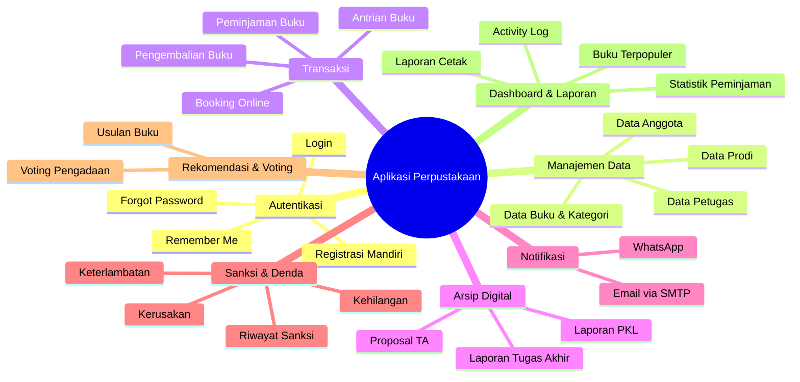
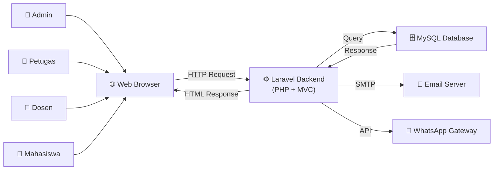
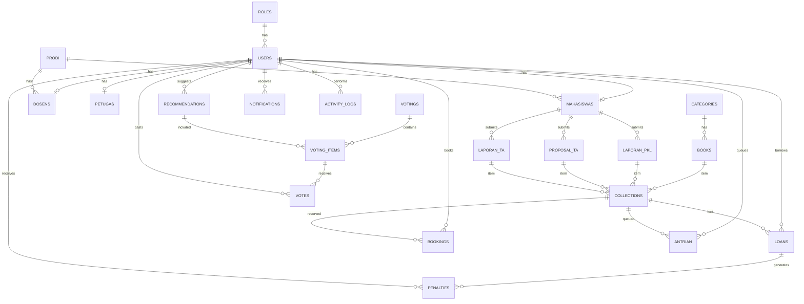

# 📚 Rancang Bangun Aplikasi Perpustakaan Berbasis Web — PSDKU POLNEP Sukamara

## Ringkasan Proposal

Proposal Tugas Akhir oleh **Ryan (NIM: 3202316109)**, Program Studi D3 Teknik Informatika, Politeknik Negeri Pontianak, dibimbing oleh **Suharsono, S.Kom., M.Kom.** — bertujuan untuk membangun **Aplikasi Perpustakaan Digital Berbasis Web** untuk PSDKU POLNEP di Kabupaten Sukamara, Kalimantan Tengah.

### Latar Belakang Masalah
- Perpustakaan PSDKU POLNEP Sukamara memiliki **3 program studi, 10 kelas, 140 mahasiswa, dan ±600 judul buku**
- Pengelolaan masih **manual** (buku jurnal harian) — pendataan anggota, buku, peminjaman, pengembalian, dan laporan
- Masalah: **tidak efisien, rawan kesalahan, duplikasi data, kesulitan pencarian**

---

## Analisis Sistem yang Akan Dibangun

### 🔑 4 Role Pengguna

| Role | Deskripsi |
|------|-----------|
| **Admin** | Hak akses tertinggi — kelola user, petugas, konfigurasi sistem, monitoring |
| **Petugas Perpustakaan** | Operasional perpustakaan — kelola buku, anggota, transaksi, sanksi, laporan |
| **Dosen** | Anggota perpustakaan — cari buku, peminjaman, pengembalian, rekomendasi |
| **Mahasiswa** | Anggota perpustakaan — sama seperti dosen + input arsip PKL/TA |

### 📋 Fitur Utama Sistem

---

## Arsitektur & Teknologi

### Stack Teknologi (Sesuai Proposal)

| Komponen | Teknologi | Keterangan |
|----------|-----------|------------|
| Bahasa Pemrograman | **PHP** | Server-side scripting |
| Framework | **Laravel** | MVC Architecture |
| Database | **MySQL** | RDBMS via Laragon |
| Web Server Lokal | **Laragon** | Apache + MySQL + PHP |
| Host Server (Testing) | **Ngrok** | Tunnel ke localhost |
| Styling | **CSS** | Tampilan halaman |
| Code Editor | **VS Code** | Editor utama |
| UI/UX Design | **Figma** | Wireframe & Mockup |

### Arsitektur Client-Server

---

## Perancangan Database (20+ Tabel)

### Entity Relationship Overview

### Daftar Tabel Lengkap

| No | Tabel | Fungsi |
|----|-------|--------|
| 1 | `roles` | Jenis peran pengguna (admin, petugas, dosen, mahasiswa) |
| 2 | `users` | Akun pengguna (email, password, no_hp, foto) |
| 3 | `mahasiswas` | Data mahasiswa (NIM, semester, relasi ke prodi) |
| 4 | `dosens` | Data dosen (NIP, relasi ke prodi) |
| 5 | `petugas` | Data petugas perpustakaan (NIP, jabatan) |
| 6 | `prodi` | Program studi |
| 7 | `categories` | Kategori buku |
| 8 | `books` | Data buku (judul, author, publisher, tahun, stok) |
| 9 | `collections` | Koleksi perpustakaan (polimorfik: buku, PKL, TA) |
| 10 | `loans` | Transaksi peminjaman (tgl_pinjam, bts_waktu, tgl_kembali, status) |
| 11 | `bookings` | Reservasi/booking buku online |
| 12 | `antrian` | Antrian peminjaman jika buku tidak tersedia |
| 13 | `penalties` | Sanksi (denda, kehilangan, kerusakan) |
| 14 | `recommendations` | Usulan/rekomendasi buku dari pengguna |
| 15 | `notifications` | Notifikasi sistem |
| 16 | `activity_logs` | Log aktivitas pengguna |
| 17 | `votings` | Kegiatan voting pengadaan buku |
| 18 | `voting_items` | Item rekomendasi dalam voting |
| 19 | `votes` | Hasil voting pengguna |
| 20 | `laporan_pkl` | Laporan PKL mahasiswa (judul, pembimbing, penguji, file) |
| 21 | `proposal_ta` | Proposal tugas akhir mahasiswa |
| 22 | `laporan_tugas_akhir` | Laporan tugas akhir mahasiswa |

---

## Proposed Changes — Rencana Implementasi

Implementasi dibagi menjadi **7 fase** sesuai prioritas dan dependensi:

---

### Fase 1: Setup Project & Fondasi

#### [NEW] Laravel Project Setup
- Inisialisasi project Laravel baru
- Konfigurasi `.env` (database MySQL, mail SMTP)
- Setup Laragon sebagai web server lokal
- Konfigurasi `config/database.php`, `config/mail.php`

#### [NEW] Database Migrations
- Buat seluruh **22 migration files** sesuai rancangan tabel di proposal
- Buat **seeders** untuk data awal (roles, prodi, kategori buku, admin default)

#### [NEW] Models & Relationships
- Buat **Eloquent Models** untuk semua tabel
- Definisikan relasi antar model (`hasOne`, `hasMany`, `belongsTo`, `morphMany`)

---

### Fase 2: Autentikasi & Manajemen User

#### [NEW] Authentication System
- Implementasi login, registrasi, forgot password menggunakan **Laravel Breeze** atau **Fortify**
- Registrasi mandiri untuk mahasiswa & dosen (dengan field: nama, email, no_hp, NIM/NIP, prodi, semester)
- Middleware role-based access control (admin, petugas, dosen, mahasiswa)

#### [NEW] Halaman Login
- Field: Email, Password
- Fitur: Remember Me, Forgot Password, link ke Sign Up

#### [NEW] Halaman Registrasi
- Pilihan role: Mahasiswa / Dosen
- Field dinamis berdasarkan role (NIM+Semester untuk mahasiswa, NIP untuk dosen)

#### [NEW] User Management (Admin)
- CRUD pengguna (admin dapat menambah/edit/hapus akun)
- Kelola petugas perpustakaan
- Konfigurasi sistem (aturan peminjaman, denda, batas waktu)

---

### Fase 3: Manajemen Data Perpustakaan

#### [NEW] Manajemen Buku
- CRUD data buku (judul, penulis, penerbit, tahun terbit, stok, kategori)
- CRUD kategori buku
- Pencarian buku berdasarkan judul atau kategori
- Status ketersediaan buku real-time

#### [NEW] Manajemen Koleksi (Collections)
- Koleksi polimorfik: Buku, Laporan PKL, Proposal TA, Laporan TA
- Tracking stok per koleksi

#### [NEW] Manajemen Anggota
- CRUD data mahasiswa & dosen
- View data anggota per prodi

---

### Fase 4: Transaksi Perpustakaan

#### [NEW] Peminjaman Buku
- Proses peminjaman oleh petugas
- Set tanggal pinjam, batas waktu, status
- Status: `dipinjam`, `dikembalikan`, `terlambat`
- Pengurangan stok otomatis

#### [NEW] Pengembalian Buku
- Proses pengembalian oleh petugas
- Form pengembalian memuat checklist pengecekan kondisi fisik buku
- Kriteria pengecekan dapat mencakup cover, halaman, kelengkapan, coretan, sobek, basah, dan kondisi lain yang ditetapkan perpustakaan
- Jika ada item checklist yang tidak memenuhi kriteria, petugas wajib mencatat kondisi temuan pada form pengembalian
- Kalkulasi keterlambatan otomatis
- Penambahan stok otomatis
- Generate sanksi jika terlambat/rusak/hilang
- Sistem menampilkan opsi tindak lanjut sanksi saat buku rusak/hilang, baik berupa penggantian buku maupun denda uang tunai
- Data hasil inspeksi fisik disimpan sebagai bagian dari riwayat pengembalian untuk kebutuhan audit

#### [NEW] Booking Online
- Mahasiswa/dosen booking buku sebelum datang ke perpustakaan
- Status booking: `pending`, `disetujui`, `dibatalkan`, `selesai`
- Petugas mengelola booking masuk

#### [NEW] Sistem Antrian
- Antrian otomatis jika buku sedang dipinjam semua
- Nomor antrian berurutan per koleksi
- Status: `menunggu`, `tersedia`, `selesai`
- Notifikasi saat giliran tiba

#### [NEW] Manajemen Sanksi/Denda
- Jenis sanksi: keterlambatan, kehilangan, kerusakan
- Kalkulasi denda otomatis
- Denda keterlambatan dihitung otomatis oleh sistem
- Denda kerusakan/kehilangan dibuat oleh petugas berdasarkan hasil pengecekan fisik saat pengembalian
- Bentuk penyelesaian sanksi mendukung penggantian buku, denda uang tunai, atau kombinasi keduanya sesuai kebijakan perpustakaan
- Petugas dapat menambahkan catatan alasan sanksi dan rincian nominal/nilai penggantian
- Riwayat sanksi per pengguna
- Status: `belum_dibayar`, `lunas`

---

### Fase 5: Arsip Digital

#### [NEW] Input Laporan PKL
- Upload file PDF & Word
- Data: judul, pembimbing, penguji, tahun
- Khusus mahasiswa

#### [NEW] Input Proposal TA
- Upload file PDF & Word
- Data: judul proposal, pembimbing, penguji, tahun

#### [NEW] Input Laporan Tugas Akhir
- Upload file PDF & Word
- Data: judul, pembimbing, penguji, tahun

#### [NEW] Pencarian Arsip Digital
- Pencarian berdasarkan judul, penulis (mahasiswa), tahun, prodi
- Peminjaman arsip digital (via tabel collections & loans)

---

### Fase 6: Fitur Tambahan

#### [NEW] Sistem Notifikasi Multi-Platform
- **Email** via SMTP (Laravel Mail)
- **WhatsApp** via API Gateway (Fonnte/WaBlas/dll)
- Notifikasi pengingat H-1 pengembalian buku
- Notifikasi saat booking disetujui
- Notifikasi saat giliran antrian tiba
- Notifikasi sanksi/denda

#### [NEW] Rekomendasi & Voting Buku
- Mahasiswa/dosen mengirim rekomendasi buku (judul, penulis, alasan)
- Petugas membuat sesi voting pengadaan buku
- Pengguna dapat vote pada item rekomendasi
- Status rekomendasi: `pending`, `disetujui`, `ditolak`

#### [NEW] Dashboard Monitoring
- **Dashboard Admin**: total user, total buku, statistik aktivitas sistem
- **Dashboard Petugas**: statistik peminjaman, buku terpopuler, antrian aktif, booking pending
- **Dashboard Mahasiswa/Dosen**: status peminjaman aktif, riwayat, denda, notifikasi

#### [NEW] Activity Logging
- Catat seluruh aktivitas pengguna dalam sistem
- Admin dapat melihat log aktivitas

#### [NEW] Laporan Perpustakaan
- Laporan peminjaman & pengembalian (per periode)
- Laporan daftar koleksi buku
- Laporan aktivitas perpustakaan
- Export/cetak laporan

---

### Fase 7: Testing & Deployment

#### Testing
- **Black Box Testing** — pengujian fungsional semua fitur
- **User Acceptance Testing (UAT)** — pengujian oleh petugas dan mahasiswa

#### Deployment
- Deploy ke server menggunakan **Ngrok** untuk tahap pengujian
- Konfigurasi production environment
- Data migration dari sistem manual ke sistem digital

---

## User Review Required

> [!IMPORTANT]
> **Teknologi Stack**: Proposal menyebutkan **PHP Laravel + MySQL + Laragon**. Apakah Anda ingin saya membangun project Laravel ini secara langsung, atau ada preferensi framework/teknologi lain?

> [!IMPORTANT]
> **Scope Prioritas**: Dengan 20+ tabel dan banyak fitur, apakah Anda ingin memulai dari fitur core terlebih dahulu (autentikasi + manajemen buku + peminjaman/pengembalian) lalu expand secara bertahap?

> [!WARNING]
> **WhatsApp Gateway**: Untuk notifikasi WhatsApp, diperlukan layanan pihak ketiga (Fonnte, WaBlas, Twilio, dll). Apakah sudah ada pilihan provider? Ini mungkin memerlukan biaya langganan.

## Open Questions

1. **Template UI**: Apakah ada preferensi template admin (AdminLTE, Mazer, Stisla) atau ingin dibuat custom?
2. **WhatsApp API**: Provider WhatsApp gateway mana yang akan digunakan?
3. **Hosting Production**: Apakah deployment final akan menggunakan shared hosting, VPS, atau cloud?
4. **Data Awal**: Apakah ada data buku/anggota existing yang perlu dimigrasi ke sistem baru?
5. **Laravel Version**: Apakah ingin menggunakan Laravel versi terbaru (Laravel 12) atau versi tertentu?

---

## Verification Plan

### Automated Tests
- Unit test untuk setiap Model & relasi
- Feature test untuk authentication flow
- Feature test untuk CRUD operations
- Feature test untuk transaksi peminjaman/pengembalian

### Manual Verification
- Black Box Testing sesuai test case per fitur
- User Acceptance Testing (UAT) dengan petugas perpustakaan
- Cross-browser testing (Chrome, Firefox, Edge)
- Responsive testing untuk berbagai ukuran layar

---

## Jadwal Implementasi (Estimasi)

| Fase | Durasi | Target |
|------|--------|--------|
| Fase 1: Setup & Fondasi | 1 minggu | Database, Models, Migrations |
| Fase 2: Auth & User Management | 1 minggu | Login, Register, Role Management |
| Fase 3: Data Perpustakaan | 1-2 minggu | CRUD Buku, Kategori, Anggota |
| Fase 4: Transaksi | 2-3 minggu | Peminjaman, Pengembalian, Booking, Antrian, Sanksi |
| Fase 5: Arsip Digital | 1 minggu | Upload & Cari PKL, Proposal, TA |
| Fase 6: Fitur Tambahan | 2-3 minggu | Notifikasi, Voting, Dashboard, Laporan |
| Fase 7: Testing & Deploy | 1-2 minggu | Black Box, UAT, Deployment |
| **Total Estimasi** | **9-13 minggu** | |
